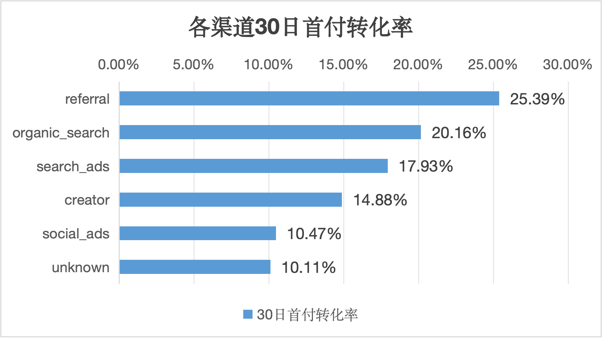
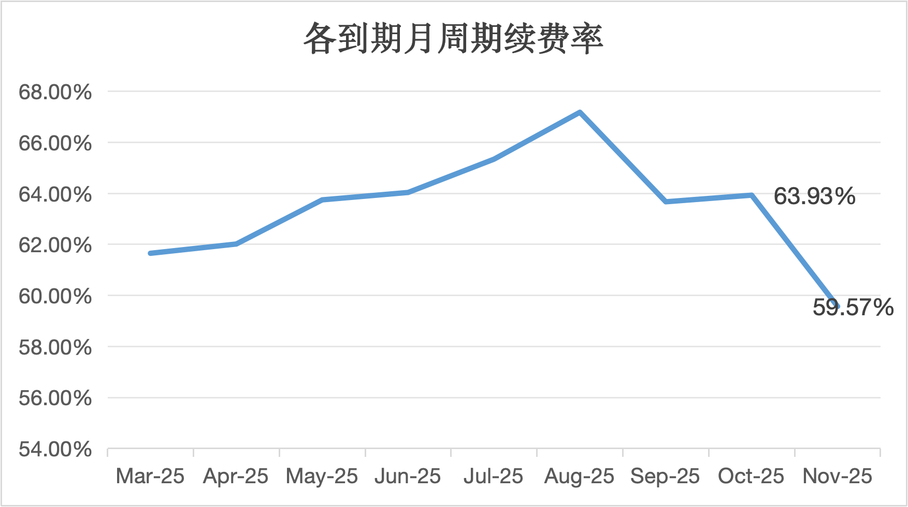

# 数据分析作品集

围绕用户增长、转化、留存及续费等业务问题，使用 MySQL 与 Excel 完成数据质量检查、指标计算、多维分析、异动分解和运营策略设计。

## 项目一：用户增长与留存分析

**业务场景：** 线上知识付费平台  
**项目性质：** 个人模拟业务分析项目，全部数据由程序合成  
**分析工具：** MySQL、Excel  
**数据规模：** 50,000名注册用户、约142万条行为事件、20,744笔订单及17,269个订阅服务周期

### 查看项目

| 内容 | 入口 |
|---|---|
| 项目说明与复现步骤 | [项目一首页](project01/README.md) |
| 完整分析报告 | [在线阅读](project01/report/analysis_report.md) |
| PDF报告 | [查看及下载](project01/report/project01_analysis_report.pdf) |
| Excel核心指标看板 | [下载看板](project01/excel/07_project_dashboard.xlsx) |
| SQL分析过程 | [查看SQL](project01/sql/) |
| Excel分析与结果数据 | [查看分析文件](project01/excel/) |

### 分析内容

- 渠道质量：比较注册后30日首次付费转化表现。
- 转化漏斗：分析注册、开始试听、完成试听至首次付费的路径。
- 用户留存：按渠道、注册月、年龄和城市等级分析D7与D30留存。
- 异动分解：区分渠道来源结构变化与渠道内部表现变化。
- 订阅续费：分析到期周期续费率，并按渠道、套餐及到期前活跃程度下钻。
- 退款与净收款：补充首付订单退款及月度现金收款分析。
- 运营方案：提出排查方向、实验方案与效果追踪指标。

### 主要发现

1. **首付转化下降主要来自渠道结构变化。**
   8月至9月，整体30日首付转化率下降约2.23个百分点，
   其中渠道结构变化贡献约−1.81个百分点。

2. **D30留存下降主要来自渠道内部表现变化。**
   同期整体D30留存率下降约1.59个百分点，
   渠道内部留存变化贡献约−1.58个百分点。

3. **续费下降需要重点排查创作者合作与自然搜索。**
   10月至11月，整体续费率由63.93%降至59.57%，
   渠道内部续费变化贡献约−3.30个百分点。

### 图表预览

### 方法与边界

- 明确观察截止时间，并按指标所需的完整观察窗口筛选样本。
- 完成数据行数核对、业务规则检查及字段缺失统计。
- 整体比例按人数或周期数汇总计算，避免直接平均分组比例。
- 变化分解属于描述性分析，不能据此认定具体业务原因。
- 运营建议与实验方案尚未实施，不代表已经取得实际业务收益。
- 缺少渠道成本等数据，尚不能完整评价ROI及渠道盈利能力。
