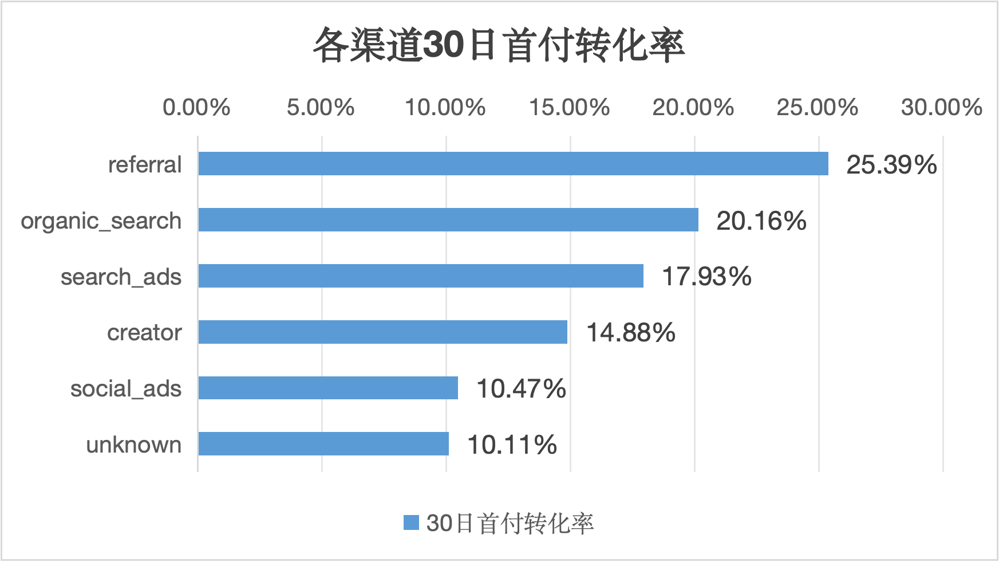
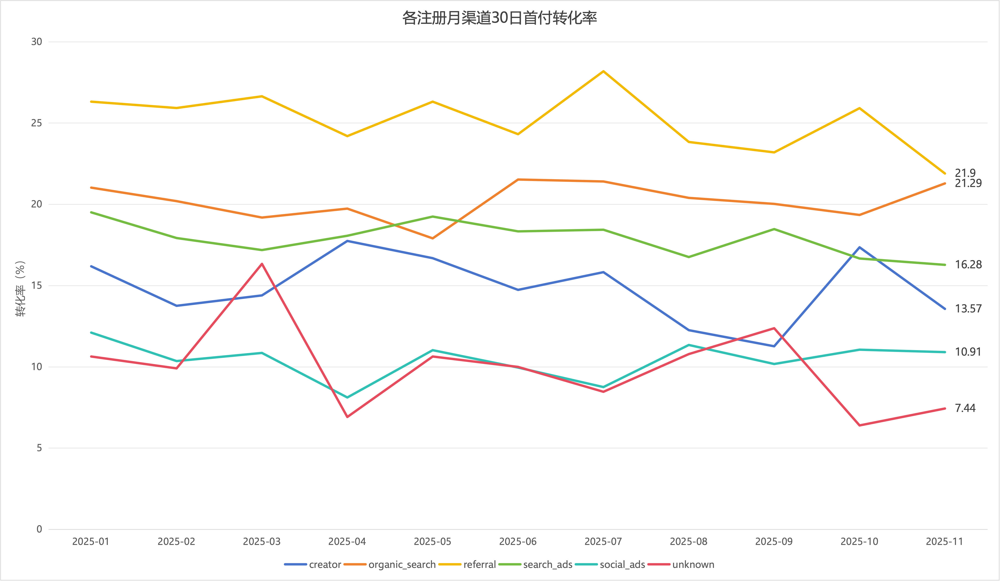
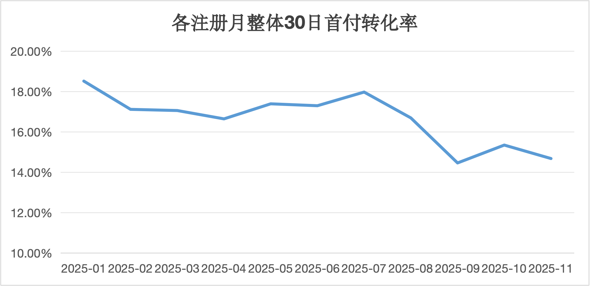
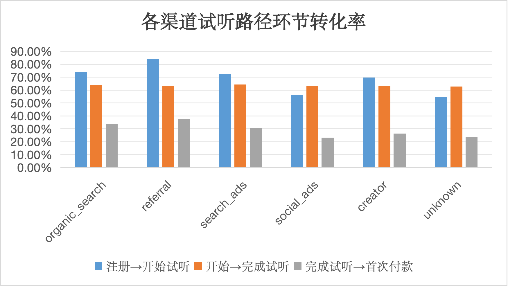
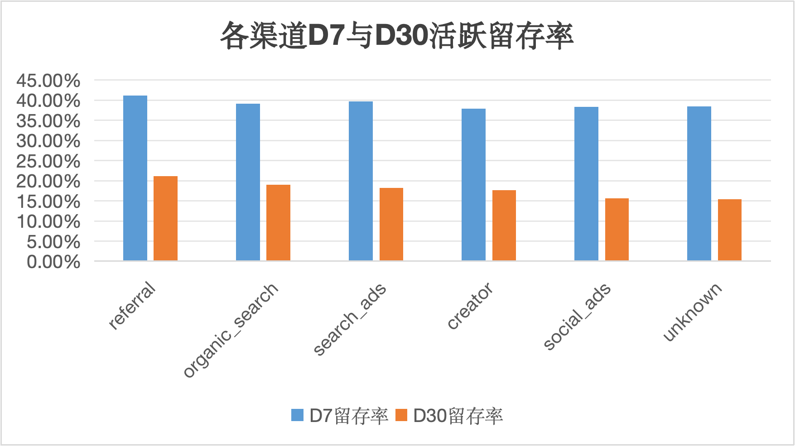
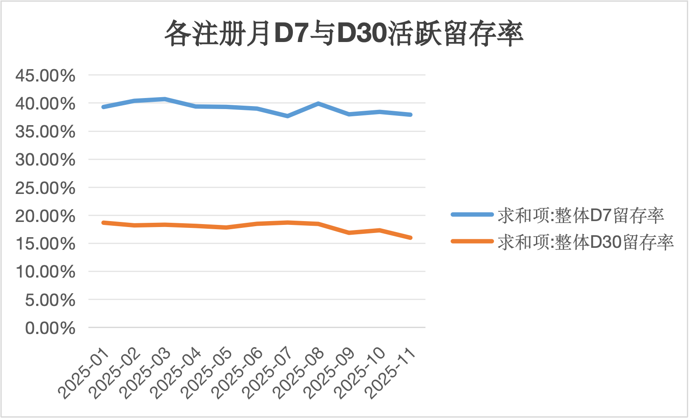
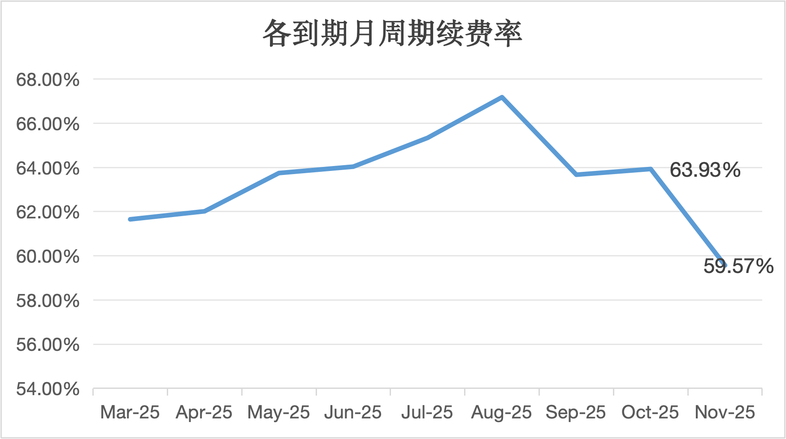
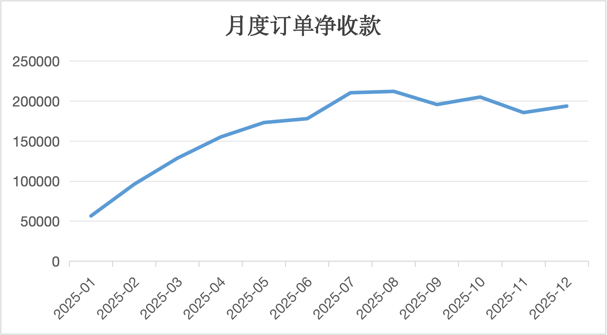

# 项目一：线上知识付费平台用户增长与留存分析

## 1. 项目背景与分析目标

本项目模拟一家线上知识付费平台。平台通过自然搜索、用户推荐、
搜索广告、社交广告和创作者合作等渠道获取用户。用户注册后可以
体验免费内容，购买付费服务，并在服务到期后续费。

分析使用MySQL提取和计算指标，使用Excel进行汇总、可视化和变化分解，
目标是评价渠道表现，定位转化、活跃留存与续费中的问题，并提出运营建议。

本项目重点回答五个业务问题：

1. 哪些渠道带来的用户更有价值？
2. 用户在哪个转化环节流失最多？
3. 不同用户群体的付费和留存表现有什么区别？
4. 续费率下降来自渠道自身表现变化，还是渠道结构变化？
5. 应优先采取什么运营措施，如何评估效果？

## 2. 数据说明

本项目为个人模拟业务分析项目，全部数据由程序合成，
不代表真实企业经营情况。

数据覆盖2025年全年，观察截止时间为2026年1月1日零点，不包含截止时刻。
数据包含5张表，分别记录渠道、用户、行为事件、订单和订阅服务周期。

| 数据表 | 内容 | 行数 |
|---|---|---:|
| marketing_channels | 首次获客渠道 | 6 |
| users | 注册用户 | 50,000 |
| user_events | 用户行为事件 | 1,420,694 |
| orders | 订单及付款、退款信息 | 20,744 |
| subscriptions | 付费服务周期及续费关联 | 17,269 |

分析前已核对导入行数，并执行8项数据质量检查，异常计数均为0。
检查覆盖事件时间、注册记录、订单金额与状态、订单和服务周期关联、
续费链以及试听与付费内容行为规则。
### 2.1 字段完整性与处理方式

| 字段 | 总记录数 | 缺失数 | 缺失率 | 处理方式 |
|---|---:|---:|---:|---|
| users.age_group | 50,000 | 2,466 | 4.93% | 保留用户，年龄分层时归入未知组 |
| users.city_tier | 50,000 | 2,013 | 4.03% | 保留用户，城市分层时归入未知组 |
| user_events.device | 1,420,694 | 13,693 | 0.96% | 保留事件，当前留存计算不依赖设备字段 |

缺失统计包括NULL、空字符串及仅含空格的值。
年龄、城市按用户统计，设备按行为事件统计。

未支付订单的付款时间、未退款订单的退款时间，
以及首购周期的上一周期编号为空，属于需结合业务状态判断的空值。

这些结果表示所检查的规则未发现异常，
数据完整性与具体业务含义仍需结合分析场景判断。

年龄与城市缺失用户保留为未知组。
未知组可能与已知组存在差异，构成人群分析的局限。
## 3. 核心指标与统计口径

### 3.1 注册后30日首付转化率

计算公式为：

30日内首次成功付款用户数 ÷ 已观察满30天的注册用户数。

时间窗口从注册时刻开始，包含注册时刻，不包含注册满30天的结束时刻。
首次成功付款取用户所有成功付款订单中最早的付款时间。
付款后退款的用户仍计为曾经付费，退款情况另行评估。

按用户首次获客渠道归因，按注册月分组。

### 3.2 试听路径漏斗

观察路径为：

注册 → 开始试听 → 完成试听 → 首次成功付款。

纳入已观察满30天的注册用户，各步骤均须发生在注册后30天窗口内。
开始试听后才能计入完成试听，完成试听后首次付款才能计入完整路径首付。

每个环节按用户去重。同一用户多次试听或多笔付款均只计一次。

同时保留所有路径首付人数，并按付款前的试听进展划分为：

- 完成试听后首付。
- 开始试听后、完成前首付。
- 首付前无试听开始记录。

当前数据缺少课程编号，试听路径按同一用户的事件先后顺序识别。

### 3.3 D7与D30活跃留存率

D7留存指注册日期后第7个自然日，至少发生一次非注册行为。
D30留存采用相同规则，目标日为注册日期后第30个自然日。

注册当天记为D0，同一用户在目标日活跃多次只计1人。

留存率为目标日活跃人数除以符合观察条件的注册人数。
对比D7与D30时，两项指标统一使用已完整观察至D30结束的注册用户。

目标日没有活跃记录，仅表示当天未活跃，不能直接据此判定用户流失。

### 3.4 到期周期续费率

计算公式为：

规定窗口内成功续费的原周期数 ÷ 符合条件的原到期周期数。

以服务周期为统计单位，同一用户可以有多次到期续费机会。
分母排除因退款撤销的原周期，并要求原周期到期后7天已完整观察。

通过下一周期的previous_subscription_id关联原周期，
核对用户一致，并检查下一周期订单的成功付款时间。

付款须发生在原周期到期前7天至到期后7天之间，包含两端。
续费后退款的订单仍计为曾成功续费，退款情况需另外评估。

按原服务周期的到期月分组，渠道采用用户首次获客渠道。
12月仅有部分到期周期满足完整观察条件，月度比较需注明范围。

### 3.5 变化分解方法

整体比例等于各组“样本占比 × 组内比例”的合计。

本项目采用先调整结构、再调整组内比例的顺序：

- 结构贡献 =（本期占比－基期占比）× 基期组内比例。
- 组内贡献 = 本期占比 ×（本期组内比例－基期组内比例）。

各组两类贡献合计等于整体比例变化，乘以100后以百分点表达。

分解结果用于定位统计变化来源，具体业务原因需进一步验证。
两类贡献的分配会随分解顺序变化。
## 4. 渠道与首次付费分析

### 4.1 分析问题

比较各渠道注册用户的30日首付转化表现，并检查整体转化率的月度变化。

### 4.2 渠道首付表现

| 渠道 | 符合观察条件的注册人数 | 30日内首付人数 | 首付转化率 |
|---|---:|---:|---:|
| 推荐 | 6,084 | 1,545 | 25.39% |
| 自然搜索 | 10,153 | 2,047 | 20.16% |
| 搜索广告 | 9,011 | 1,616 | 17.93% |
| 创作者合作 | 6,235 | 928 | 14.88% |
| 社交广告 | 12,992 | 1,360 | 10.47% |
| 来源未知 | 1,405 | 142 | 10.11% |

推荐渠道的首付转化率最高，为25.39%。
自然搜索贡献的首付人数最多，为2,047人。
社交广告的符合条件注册人数最多，但首付转化率为10.47%，
需要结合后续留存、续费、退款和获客成本进一步评价其价值。

### 4.3 月度趋势

2025年1—11月，推荐渠道的月度首付转化率均高于其他渠道。
社交广告各月转化率处于较低水平。

整体首付转化率从8月的16.70%下降至9月的14.47%，下降约2.23个百分点。
同期符合条件的注册人数从4,221人变为4,174人，
首付人数从705人降至604人。

月度趋势图使用完整注册月份1—11月。
12月只有部分注册用户满足30天观察条件，未纳入趋势图。

### 4.4 8月至9月首付转化率变化分解

为定位下降来源，将整体变化拆为渠道结构变化和渠道内部转化率变化。

| 变化来源 | 对整体首付转化率的影响 | 占总降幅 |
|---|---:|---:|
| 渠道结构变化 | -1.81个百分点 | 约81% |
| 渠道内部转化率变化 | -0.42个百分点 | 约19% |
| 合计 | -2.23个百分点 | 100% |

社交广告用户占比从21.70%升至44.47%，
推荐和自然搜索渠道占比分别下降约7.13、7.31个百分点。

按先调整渠道结构、再调整渠道内部转化率的分解顺序，
本次整体下降主要对应获客结构向较低首付转化渠道倾斜。

### 4.5 阶段性判断

推荐渠道的首付转化表现持续领先，自然搜索贡献了较多首付用户。
社交广告规模较大、首付转化较低，其用户占比提高影响了整体转化表现。

后续通过试听漏斗与付款路径分析，定位渠道内部的转化差异。
当前缺少渠道投放成本，预算调整还需要补充成本与后续价值评估。
## 5. 试听漏斗与付款路径分析

### 5.1 分析问题

比较各渠道从注册、开始试听、完成试听到首次付款的转化表现，
并进一步拆分社交广告渠道8月至9月的首付变化。

### 5.2 各渠道试听路径表现

| 渠道 | 注册人数 | 开始试听人数 | 完成试听人数 | 完整试听路径首付人数 | 所有路径首付人数 |
|---|---:|---:|---:|---:|---:|
| 自然搜索 | 10,153 | 7,540 | 4,813 | 1,617 | 2,047 |
| 推荐 | 6,084 | 5,113 | 3,242 | 1,211 | 1,545 |
| 搜索广告 | 9,011 | 6,524 | 4,192 | 1,279 | 1,616 |
| 社交广告 | 12,992 | 7,325 | 4,641 | 1,076 | 1,360 |
| 创作者合作 | 6,235 | 4,351 | 2,740 | 722 | 928 |
| 来源未知 | 1,405 | 766 | 480 | 114 | 142 |

各阶段按用户去重，且要求事件按顺序发生在注册后30天内。
完整试听路径首付人数仅包括完成试听之后才首次付款的用户。

| 渠道 | 注册→开始试听 | 开始→完成试听 | 完成试听→之后首次付款 |
|---|---:|---:|---:|
| 自然搜索 | 74.26% | 63.83% | 33.60% |
| 推荐 | 84.04% | 63.41% | 37.35% |
| 搜索广告 | 72.40% | 64.26% | 30.51% |
| 社交广告 | 56.38% | 63.36% | 23.18% |
| 创作者合作 | 69.78% | 62.97% | 26.35% |
| 来源未知 | 54.52% | 62.66% | 23.75% |

社交广告与推荐渠道在注册至开始试听环节相差27.66个百分点，
而开始至完成试听的转化率接近。

推荐渠道作为高转化表现参照，用于识别差异。
各渠道用户的初始意愿和构成可能不同，差异的业务原因仍需验证。

三段比例分别使用上一环节人数作为分母。
最后一段中，部分用户可能已经在完成试听前付款，
因此未进入完整路径首付人数不能直接视为未付费流失。

### 5.3 社交广告8月至9月的漏斗变化

| 指标 | 8月 | 9月 |
|---|---:|---:|
| 注册人数 | 916 | 1,856 |
| 开始试听人数 | 518 | 1,043 |
| 完成试听人数 | 323 | 663 |
| 完整试听路径首付人数 | 75 | 148 |
| 所有路径首付人数 | 104 | 189 |
| 注册→开始试听 | 56.55% | 56.20% |
| 开始→完成试听 | 62.36% | 63.57% |
| 完成试听→之后首次付款 | 23.22% | 22.32% |
| 所有路径首付率 | 11.35% | 10.18% |

9月注册规模扩大，各环节人数均增加，但首付人数增长慢于注册人数。
试听完成率提高，同时完成试听后首次付款的比例下降，
说明不同环节的表现变化方向并不一致。

### 5.4 首付路径拆分

将30日内首付用户按付款前的试听进展分为三个互斥组。
每条路径的首付率均以该渠道当月符合条件的注册人数为分母。

| 首付路径 | 8月人数 | 9月人数 | 8月首付率 | 9月首付率 | 变化 |
|---|---:|---:|---:|---:|---:|
| 完成试听后首付 | 75 | 148 | 8.19% | 7.97% | -0.21个百分点 |
| 开始试听后、完成前首付 | 19 | 23 | 2.07% | 1.24% | -0.84个百分点 |
| 首付前无试听开始记录 | 10 | 18 | 1.09% | 0.97% | -0.12个百分点 |
| 合计 | 104 | 189 | 11.35% | 10.18% | -1.17个百分点 |

变化值使用未四舍五入的原始比例计算，
可能与表中显示比例直接相减存在0.01个百分点差异。

社交广告内部下降最多的是开始试听后、完成前首付路径，
对应约0.84个百分点的下降。

该数值以社交广告注册人数为分母，
平台整体下降约2.23个百分点以全部渠道注册人数为分母，
两者需区分统计范围。

### 5.5 跨渠道验证

| 渠道 | 完成试听后首付率变化 | 开始试听后、完成前首付率变化 | 首付前无试听开始记录首付率变化 | 整体首付率变化 |
|---|---:|---:|---:|---:|
| 自然搜索 | +0.85 | -0.25 | -0.97 | -0.37 |
| 推荐 | -0.53 | +0.10 | -0.20 | -0.63 |
| 搜索广告 | +0.62 | +0.74 | +0.36 | +1.72 |
| 社交广告 | -0.21 | -0.84 | -0.12 | -1.17 |
| 创作者合作 | -0.81 | -0.47 | +0.30 | -0.98 |
| 来源未知 | -0.78 | +2.14 | +0.23 | +1.59 |

本表单位均为百分点，变化方向为9月减8月。

各渠道的变化集中在不同付款路径。
开始试听后、完成前首付路径的下降在社交广告中最明显，
搜索广告的三条路径则均有改善。

### 5.6 阶段性判断

社交广告进入试听的比例较低，8月至9月的首付下降
主要集中在开始试听后、完成前付款的路径。

后续可结合广告人群、首次使用引导、优惠及跟进记录调查原因。
当前数据仅支持定位变化所在的环节与路径，
具体业务原因和干预效果仍待验证。
## 6. 用户活跃留存分析

### 6.1 分析问题

比较各渠道的D7、D30活跃留存表现，观察不同注册月的变化，
并对8月至9月的D30留存下降进行分解与人群分层。

D7和D30对比统一使用已完整观察至D30结束的注册用户。
目标日内至少发生一次非注册行为即计为留存。

### 6.2 渠道留存表现

| 渠道 | 符合观察条件的注册人数 | D30活跃人数 | D30留存率 |
|---|---:|---:|---:|
| 推荐 | 6,084 | 1,289 | 21.19% |
| 自然搜索 | 10,153 | 1,932 | 19.03% |
| 搜索广告 | 9,011 | 1,637 | 18.17% |
| 创作者合作 | 6,235 | 1,100 | 17.64% |
| 社交广告 | 12,992 | 2,034 | 15.66% |
| 来源未知 | 1,405 | 217 | 15.44% |

推荐渠道D30留存率最高，较社交广告高5.53个百分点。
推荐渠道同时表现出较高的首付转化率和D30活跃留存率。

以上结果描述注册后的用户表现。
渠道价值判断还需要结合续费、退款及获客成本。

### 6.3 注册月队列趋势

| 注册月 | 注册人数 | D7活跃人数 | D30活跃人数 | D7留存率 | D30留存率 |
|---|---:|---:|---:|---:|---:|
| 2025-01 | 4,167 | 1,638 | 778 | 39.31% | 18.67% |
| 2025-02 | 3,918 | 1,583 | 713 | 40.40% | 18.20% |
| 2025-03 | 4,195 | 1,708 | 768 | 40.72% | 18.31% |
| 2025-04 | 4,155 | 1,637 | 752 | 39.40% | 18.10% |
| 2025-05 | 4,155 | 1,634 | 740 | 39.33% | 17.81% |
| 2025-06 | 4,195 | 1,637 | 775 | 39.02% | 18.47% |
| 2025-07 | 4,204 | 1,584 | 786 | 37.68% | 18.70% |
| 2025-08 | 4,221 | 1,685 | 779 | 39.92% | 18.46% |
| 2025-09 | 4,174 | 1,586 | 704 | 38.00% | 16.87% |
| 2025-10 | 4,285 | 1,647 | 742 | 38.44% | 17.32% |
| 2025-11 | 4,078 | 1,547 | 652 | 37.94% | 15.99% |
| 合计 | 45,747 | 17,886 | 8,189 | 39.10% | 17.90% |

月度趋势使用1—11月完整注册队列。
12月仅部分注册用户满足D30观察条件，未纳入该趋势。

9—11月的D30留存率均低于1—8月。
8月至9月，D30留存率由18.46%降至16.87%，下降约1.59个百分点。

D7与D30分别判断两个目标日的活跃情况。
用户可能D7未活跃、D30再次活跃，
两个比例之间的差值不能直接作为用户流失率。

### 6.4 8月至9月D30留存变化分解

| 变化来源 | 对整体D30留存率的影响 |
|---|---:|
| 渠道结构变化 | 约-0.0044个百分点 |
| 渠道内部留存变化 | 约-1.5846个百分点 |
| 合计 | 约-1.5890个百分点 |

按本项目选定的分解顺序，渠道结构变化的净影响接近0，
下降主要对应渠道内部留存表现变化。

8月社交广告D30留存率为18.67%，接近当月整体18.46%。
因此，保持8月各渠道留存率时，
其占比提高对整体留存的影响较小。

| 渠道 | 8月D30留存率 | 9月D30留存率 | 渠道内部变化对整体的贡献 |
|---|---:|---:|---:|
| 创作者合作 | 16.77% | 17.33% | +0.06个百分点 |
| 自然搜索 | 20.00% | 15.58% | -0.71个百分点 |
| 推荐 | 19.19% | 20.72% | +0.13个百分点 |
| 搜索广告 | 17.32% | 19.48% | +0.36个百分点 |
| 社交广告 | 18.67% | 15.57% | -1.38个百分点 |
| 来源未知 | 17.27% | 15.24% | -0.05个百分点 |

社交广告和自然搜索是渠道内部下降的主要贡献来源，
部分其他渠道的改善抵消了一部分下降。
分项显示值经过四舍五入，可能与未舍入合计存在微小差异。

### 6.5 年龄分层验证

进一步检查自然搜索、社交广告的年龄构成与组内留存变化。

| 渠道 | 年龄组 | 8月用户占比 | 9月用户占比 | 8月D30留存率 | 9月D30留存率 |
|---|---|---:|---:|---:|---:|
| 自然搜索 | 18—24 | 25.45% | 26.71% | 20.24% | 19.44% |
| 自然搜索 | 25—34 | 40.81% | 37.98% | 19.31% | 13.28% |
| 自然搜索 | 35—44 | 20.10% | 21.22% | 24.12% | 14.69% |
| 社交广告 | 18—24 | 27.73% | 26.08% | 21.65% | 17.56% |
| 社交广告 | 25—34 | 37.99% | 40.52% | 18.10% | 14.10% |
| 社交广告 | 35—44 | 22.60% | 20.80% | 18.84% | 17.10% |

本表展示人数较多的三个年龄组，
完整分组结果保存在Excel的“年龄分层留存”工作表。

主要年龄组占比变化较小，留存下降在多个年龄组内部仍存在。
当前结果提示，仅靠年龄构成变化难以充分解释渠道整体下降。
尚未对年龄构成进行独立贡献分解或显著性检验。

### 6.6 城市等级分层验证

| 渠道 | 城市组 | 8月用户占比 | 9月用户占比 | 8月D30留存率 | 9月D30留存率 |
|---|---|---:|---:|---:|---:|
| 自然搜索 | 一线 | 19.09% | 19.58% | 19.58% | 15.15% |
| 自然搜索 | 二线 | 24.95% | 29.67% | 21.46% | 10.50% |
| 社交广告 | 一线 | 21.51% | 19.18% | 17.77% | 14.04% |
| 社交广告 | 二线 | 29.15% | 27.80% | 21.35% | 14.34% |
| 社交广告 | 三线及以下 | 23.91% | 26.13% | 19.18% | 16.08% |

本表展示下降较明显的城市组，
完整分组结果保存在Excel的“城市分层留存”工作表。

两个渠道的二线城市组均出现较明显的组内留存下降。
也存在改善的组，例如社交广告的新一线城市组，
留存率由14.21%升至18.20%。

年龄分层与城市分层包含重叠用户，
各维度发现的下降幅度不能直接相加。
组内变化属于描述性结果，仍需结合样本量和统计不确定性判断。

### 6.7 阶段性判断

8月至9月的D30留存下降主要对应渠道内部表现变化，
社交广告和自然搜索应优先调查。

年龄与城市分层后，下降仍在多个组内部存在。
后续需要结合内容使用、服务反馈及运营活动记录验证具体原因。

首付转化下降主要对应渠道结构变化，
D30留存下降主要对应渠道内部变化，
说明不同指标需要分别诊断。

## 7. 订阅续费分析

### 7.1 分析问题

检查整体续费率的月度变化，判断下降主要对应渠道结构变化，
还是渠道内部续费表现变化，并进一步检查套餐与活跃程度。

统计单位为到期服务周期，同一用户可以贡献多个周期。
续费窗口为原周期到期前7天至到期后7天，包含两端。
具体分母与续费判定规则见第3节。

### 7.2 整体月度续费表现

| 原周期到期月 | 符合条件的到期周期数 | 成功续费周期数 | 续费率 |
|---|---:|---:|---:|
| 2025-02 | 304 | 190 | 62.50% |
| 2025-03 | 738 | 455 | 61.65% |
| 2025-04 | 1,061 | 658 | 62.02% |
| 2025-05 | 1,291 | 823 | 63.75% |
| 2025-06 | 1,357 | 869 | 64.04% |
| 2025-07 | 1,587 | 1,037 | 65.34% |
| 2025-08 | 1,676 | 1,126 | 67.18% |
| 2025-09 | 1,737 | 1,106 | 63.67% |
| 2025-10 | 1,719 | 1,099 | 63.93% |
| 2025-11 | 1,625 | 968 | 59.57% |
| 2025-12 | 1,176 | 711 | 60.46% |

8月之后续费率出现波动下降。
10月至11月，续费率由63.93%降至59.57%，下降约4.36个百分点。
本轮选择这两个完整到期月份进行变化分解。

12月仅包含到期后7天已完整观察的部分周期，比较时需注意覆盖范围。

图示展示3月至11月趋势，完整数据见上表。

### 7.3 10月至11月渠道表现

| 渠道 | 10月到期周期数 | 11月到期周期数 | 10月续费率 | 11月续费率 |
|---|---:|---:|---:|---:|
| 创作者合作 | 164 | 169 | 65.85% | 53.85% |
| 自然搜索 | 507 | 443 | 66.86% | 60.05% |
| 推荐 | 464 | 418 | 74.78% | 75.84% |
| 搜索广告 | 358 | 334 | 62.29% | 58.98% |
| 社交广告 | 199 | 239 | 34.67% | 35.15% |
| 来源未知 | 27 | 22 | 48.15% | 59.09% |

创作者合作与自然搜索的续费率均下降。
推荐与社交广告略有改善。
来源未知渠道周期数较少，比例容易受到少量记录变化影响。

### 7.4 整体续费下降的变化分解

渠道结构使用各渠道到期周期数占全部符合条件周期数的比例。

| 变化来源 | 对整体续费率的影响 | 占总降幅 |
|---|---:|---:|
| 渠道结构变化 | -1.06个百分点 | 约24% |
| 渠道内部续费率变化 | -3.30个百分点 | 约76% |
| 合计 | -4.36个百分点 | 100% |

按先调整渠道结构、再调整渠道内部续费率的分解顺序，
渠道内部变化是本次下降的主要组成部分。

| 渠道 | 渠道结构贡献 | 渠道内部续费贡献 |
|---|---:|---:|
| 创作者合作 | +0.57 | -1.25 |
| 自然搜索 | -1.49 | -1.86 |
| 推荐 | -0.95 | +0.27 |
| 搜索广告 | -0.17 | -0.68 |
| 社交广告 | +1.09 | +0.07 |
| 来源未知 | -0.10 | +0.15 |

本表贡献单位均为百分点。
合计使用未四舍五入数值计算，可能与显示分项之和存在微小差异。

自然搜索与创作者合作的渠道内部变化，
合计拉低整体续费率约3.11个百分点，应优先调查。

渠道结构方面，续费率较低的社交广告到期周期占比提高，
自然搜索、推荐渠道占比下降，结构变化净影响约为-1.06个百分点。
单个渠道结构贡献需与其他渠道合并解读。

### 7.5 原套餐分层验证

为检查套餐构成是否提供解释，将重点渠道按原到期套餐拆分。
D30表示30天套餐，D90表示90天套餐。

| 渠道 | 原套餐 | 10月周期数 | 11月周期数 | 10月套餐占比 | 11月套餐占比 | 10月续费率 | 11月续费率 |
|---|---|---:|---:|---:|---:|---:|---:|
| 创作者合作 | D30 | 133 | 141 | 81.10% | 83.43% | 66.17% | 53.19% |
| 创作者合作 | D90 | 31 | 28 | 18.90% | 16.57% | 64.52% | 57.14% |
| 自然搜索 | D30 | 406 | 364 | 80.08% | 82.17% | 64.78% | 59.62% |
| 自然搜索 | D90 | 101 | 79 | 19.92% | 17.83% | 75.25% | 62.03% |

两个渠道的套餐占比变化约为2个百分点，
同时D30、D90套餐内部均出现续费率下降。

创作者合作的D30套餐占到期周期八成以上，且续费率下降约12.97个百分点，
是后续调查的重点。
自然搜索两类套餐均需关注。

当前结果说明下降在同套餐内部仍存在。
套餐结构的独立贡献尚未单独分解。

### 7.6 到期前活跃程度验证

检验假设为低活跃周期占比增加，是否与续费下降有关。

观察窗口选择原周期到期前第14天至第7天，
左端包含、右端不包含，位于续费付款窗口开始之前。
活跃天数按窗口内非注册行为发生的自然日期去重计算。

将周期划分为0天、1—2天、3天及以上三组。
阈值为本次探索性分析选择。
0天仅表示该窗口内没有行为记录。

| 渠道 | 活跃组 | 10月周期数 | 11月周期数 | 10月组占比 | 11月组占比 | 10月续费率 | 11月续费率 |
|---|---|---:|---:|---:|---:|---:|---:|
| 创作者合作 | 0天 | 44 | 37 | 26.83% | 21.89% | 75.00% | 64.86% |
| 创作者合作 | 1—2天 | 77 | 86 | 46.95% | 50.89% | 64.94% | 48.84% |
| 创作者合作 | 3天及以上 | 43 | 46 | 26.22% | 27.22% | 58.14% | 54.35% |
| 自然搜索 | 0天 | 149 | 107 | 29.39% | 24.15% | 66.44% | 64.49% |
| 自然搜索 | 1—2天 | 251 | 249 | 49.51% | 56.21% | 68.13% | 60.24% |
| 自然搜索 | 3天及以上 | 107 | 87 | 21.10% | 19.64% | 64.49% | 54.02% |

两个渠道的0天活跃组占比均减少，各活跃组内部续费率均下降。
当前数据不支持0天活跃周期占比增加导致续费下降的假设。

活跃程度与续费率未呈现一致递增关系。
因此，暂不将这一活跃分组作为唯一干预依据。

窗口按时刻截取、活跃天数按自然日期计数，
7×24小时窗口可能跨越8个自然日期。

### 7.7 对管理层第四问的回答

10月至11月的续费下降同时对应渠道结构变化和渠道内部表现变化，
按本次分解顺序，后者贡献约76%，是主要部分。

自然搜索和创作者合作是渠道内部下降的主要贡献来源。
套餐分层、活跃分层后，下降仍然存在。

当前分析已定位重点调查对象。
具体业务原因需要结合服务反馈、续费触达、优惠活动等数据验证。
### 7.8 首付退款与月度净收款

#### 首付订单30日退款率

每个用户取最早的一笔成功付款订单，
仅纳入付款后已观察满30天的订单。
退款窗口为付款时刻起30天，包含付款时刻，不包含窗口结束时刻。

| 渠道 | 符合条件的首付订单数 | 30日退款订单数 | 30日退款率 |
|---|---:|---:|---:|
| 自然搜索 | 1,993 | 82 | 4.11% |
| 推荐 | 1,509 | 72 | 4.77% |
| 搜索广告 | 1,567 | 70 | 4.47% |
| 社交广告 | 1,282 | 56 | 4.37% |
| 创作者合作 | 895 | 30 | 3.35% |
| 来源未知 | 139 | 7 | 5.04% |

推荐渠道首付转化表现较好，同时存在4.77%的首付订单30日退款率，
评价渠道价值时需要结合退款情况。

来源未知渠道仅139笔符合条件的首付订单，
比例容易受少量订单变化影响。

本表按首次付款时间筛选，
与此前按注册时间筛选的30日首付转化表用户范围不同，
两表比例不直接相乘。尚未检验渠道退款率差异的统计显著性。

#### 月度净收款

按付款发生月汇总收款，按退款发生月汇总退款，
包含首次付款及后续续费订单。

净收款 = 当月收款金额－当月退款金额。

| 月份 | 收款（元） | 退款（元） | 净收款（元） |
|---|---:|---:|---:|
| 2025-01 | 58,880 | 2,320 | 56,560 |
| 2025-02 | 98,806 | 2,614 | 96,192 |
| 2025-03 | 133,710 | 4,895 | 128,815 |
| 2025-04 | 160,395 | 5,118 | 155,277 |
| 2025-05 | 177,525 | 4,233 | 173,292 |
| 2025-06 | 183,718 | 5,583 | 178,135 |
| 2025-07 | 215,306 | 4,779 | 210,527 |
| 2025-08 | 219,718 | 7,469 | 212,249 |
| 2025-09 | 200,532 | 4,719 | 195,813 |
| 2025-10 | 209,410 | 4,273 | 205,137 |
| 2025-11 | 192,569 | 6,845 | 185,724 |
| 2025-12 | 199,242 | 5,380 | 193,862 |

10月至11月净收款减少19,413元，
其中收款减少16,841元，退款增加2,572元。

该变化与同期续费率下降方向一致。
净收款按资金发生月统计，续费率按原周期到期月统计，
目前尚未量化续费变化对净收款下降的具体影响。

净收款反映订单记录中的收退款情况，
成本扣除与会计收入确认需要另外处理。
## 8. 运营建议与效果评估

### 8.1 策略依据与优先级

优先级依据已观察到的业务影响、可执行性及证据完整程度安排。
以下措施为分析建议，尚未实施。

| 优先级 | 分析依据 | 建议措施 | 执行团队 |
|---|---|---|---|
| P1 | 自然搜索、创作者合作的续费下降影响较大 | 排查重点渠道的服务反馈、续费触达和优惠变化 | 运营、服务团队 |
| P1 | 续费下降在不同套餐与活跃组内部仍存在 | 验证标准化到期提醒能否改善续费 | 用户运营、产品团队 |
| P2 | 社交广告注册至开始试听比例较低 | 测试首次使用引导与试听入口优化 | 增长运营、产品团队 |
| P2 | 社交广告占比提高影响整体首付表现 | 补齐渠道成本，综合评价获客与后续价值 | 投放、数据团队 |

### 8.2 重点渠道续费排查

调查对象为自然搜索、创作者合作渠道，
重点关注创作者合作D30套餐及自然搜索两类套餐。

对10月和11月的续费、未续费周期进行对比抽样，
兼顾不同套餐及续费次数，核对以下信息：

- 服务内容、权益或使用流程是否调整。
- 续费提醒的覆盖率、发送时间与送达情况。
- 价格、优惠、自动续费规则是否变化。
- 用户反馈、投诉及未续费原因。
- 首购后首次到期与多次续费周期的构成是否变化。

预期产出为经核对的业务变化清单与待验证假设。
当前数据缺少上述记录，具体原因仍需调查。

### 8.3 到期提醒实验

实验目标为验证标准化提醒是否提高规定窗口内的续费率。
提醒方案属于待检验措施，当前结果尚未证明提醒不足导致下降。

| 要素 | 设计 |
|---|---|
| 实验对象 | 自然搜索、创作者合作渠道，即将进入到期前7天窗口、原服务周期有效的用户 |
| 入组时间 | 到期前7天，按当时可获得的信息判断资格 |
| 分组单位 | 用户，同一用户始终保留在同一组 |
| 分配方式 | 在渠道、原套餐分层内随机分配 |
| 对照组 | 沿用既有续费流程 |
| 实验组 | 增加到期前7天、前1天提醒，说明权益、到期日期及续费入口 |
| 首轮分析范围 | 每个用户的首个符合条件周期 |
| 主要指标 | 到期前后7天内成功续费周期数÷入组周期数 |
| 辅助指标 | 提醒送达率、点击率、人均续费净收款 |
| 保护指标 | 退订率、投诉率、续费后退款率 |

入组后按原随机分组分析，保留未送达、未点击用户，
避免只分析实际接收或参与提醒的人。

入组时已经退款撤销的原周期不进入实验。
入组后发生退款、未收到提醒等情况仍保留在原分组中，
并记录相应结果。

观察至每个入组周期到期后7天结束，再汇总主要指标。
退款与净收款另设统一的付款后观察窗口。
退款窗口长度、样本量和实验停止规则在实验前确定。

样本量根据同期基准续费率、最小可识别提升幅度、
显著性水平和统计功效计算。

效果评估报告实验组与对照组的续费率差值及置信区间，
并结合退款、投诉、触达成本与净收款判断是否扩大实施。

### 8.4 首次使用引导实验

实验目标为检验更清晰的试听入口与引导是否改善社交广告用户转化。

| 要素 | 设计 |
|---|---|
| 实验对象 | 社交广告渠道新注册用户 |
| 分组方式 | 注册时按用户随机分组 |
| 对照组 | 现有首次使用流程 |
| 实验组 | 优化试听入口、内容价值说明和开始试听步骤 |
| 主要指标 | 注册后30日首付转化率 |
| 过程指标 | 30日内开始试听率、顺序完成试听率 |
| 保护指标 | 退款率、投诉率及D30活跃留存率 |

每批用户均等待相应观察窗口完整结束后评价。
过程指标用于理解作用环节，
最终结合首付表现和保护指标判断业务价值。

### 8.5 渠道价值评估所需补充数据

当前缺少曝光、点击和投放成本数据。
建议按日期和渠道补充投放费用，
明确归因及退款口径，再计算获客成本与后续回收情况。

将首付、活跃留存、续费、退款和净收款结合，
评估不同渠道的获客价值。
预算调整需综合成本、规模和用户后续表现。

### 8.6 预期影响与验证状态

续费提醒预期改善到期信息触达，首次使用引导预期降低试听进入阻力。
实际影响方向和幅度由实验验证。

本项目已完成历史模拟数据分析与实验方案设计，
尚未实施运营干预或形成实验结果。
后续复盘应记录执行情况、指标变化、保护指标及下一轮调整。
## 9. 总结与局限

### 9.1 核心发现

本项目围绕获客、试听、首付、活跃留存和续费，
使用SQL计算指标，通过Excel进行汇总、可视化和变化分解。

| 业务问题 | 主要发现 |
|---|---|
| 哪些渠道表现较好？ | 推荐渠道首付转化率为25.39%，D30活跃留存率为21.19%；自然搜索贡献首付人数最多 |
| 首付变化出现在哪里？ | 8月至9月整体首付率下降约2.23个百分点，按选定分解顺序，渠道结构变化贡献约81% |
| 试听路径有什么差异？ | 社交广告进入试听比例较低，其月度首付下降主要集中在开始试听后、完成前付款路径 |
| 活跃留存为何下降？ | 8月至9月D30留存下降约1.59个百分点，主要对应渠道内部变化，重点渠道为社交广告与自然搜索 |
| 续费下降来自哪里？ | 10月至11月续费率下降约4.36个百分点，渠道内部变化贡献约76%，自然搜索与创作者合作影响较大 |
| 优先采取什么措施？ | 调查重点渠道续费变化，验证到期提醒与首次使用引导，并补充渠道成本数据 |

### 9.2 假设验证记录

| 假设或检查方向 | 数据结果 | 当前判断 |
|---|---|---|
| 首付下降与渠道结构变化有关 | 结构变化贡献约-1.81个百分点 | 在本次分解方法下得到支持 |
| D30留存下降主要由渠道结构变化解释 | 结构净影响约-0.0044个百分点 | 当前结果不支持其为主要来源 |
| 年龄或城市构成可以充分解释重点渠道留存下降 | 多个年龄组、城市组内部仍有下降 | 仅靠所检查的构成变化解释不足，尚未联合调整 |
| 套餐构成可以充分解释重点渠道续费下降 | 两渠道D30、D90套餐内部均下降 | 下降在同套餐内部仍存在 |
| 0天活跃周期占比增加导致续费下降 | 两渠道0天组占比均减少 | 当前结果不支持 |

### 9.3 数据与方法局限

- 数据全部由程序合成，分析结果适用于本模拟场景，
  对真实业务的迁移需要重新核对数据和规则。
- 渠道采用注册时首次来源，无法反映多次触达及多渠道共同影响。
- 缺少曝光、点击、投放成本与服务成本，尚不能完整评价渠道投入产出。
- 缺少广告素材、运营触达、活动、服务反馈及未续费原因，
  具体业务原因仍需补充证据。
- 试听事件缺少课程编号，路径按用户层面的事件顺序识别。
- D7、D30仅描述目标日活跃，不能直接用于判定永久流失。
- 续费以服务周期为单位，同一用户可能出现多次，
  后续统计推断需考虑用户内记录的相关性。
- 本轮未开展显著性检验，小样本分组的比例变化需谨慎解释。
- 变化分解属于描述性分析，贡献分配取决于所选分解顺序。
- 已补充首付订单30日退款率及月度净收款分析。
  续费后退款率、退款后的有效续费表现，以及统一注册队列下的
  退款调整转化指标仍待后续研究。
- 12月部分指标的观察窗口不完整，月度趋势比较已注明统计范围。

### 9.4 后续工作

进一步区分首购到期与多次续费周期，
结合服务、触达及活动记录调查下降原因。

补充渠道成本与续费退款分析，完善渠道后续价值评价。

按预先确定的实验方案完成样本量计算、
实施追踪及效果复盘。

## 10. 成果文件与复现入口

### 10.1 数据与说明

- [项目说明及字段字典](../README.md)
- 原始数据位于项目的 `data/` 文件夹。
- [模拟数据生成程序](../generate.py)

生成程序会覆盖对应CSV，使用前应了解其输出位置。

### 10.2 SQL计算过程

- [01 建表](../sql/01_schema.sql)
- [02 批量导入](../sql/02_load.sql)
- [03 数据质量检查](../sql/03_checks.sql)
- [04 渠道与首付分析](../sql/04_acquisition_conversion.sql)
- [05 试听漏斗与付款路径](../sql/05_conversion_funnel.sql)
- [06 活跃留存分析](../sql/06_user_retention.sql)
- [07 订阅续费分析](../sql/07_subscription_renewal.sql)
- [08 退款与净收款分析](../sql/08_refund_cashflow.sql)
- [09 字段完整性检查](../sql/09_data_quality_summary.sql)

实际导入通过DBeaver向导完成，02脚本作为批量导入方式保留。
运行分析查询时，应包含其依赖的完整WITH定义。

### 10.3 Excel分析工作簿

- [渠道与首付分析](../excel/01_channel_conversion.xlsx)
- [试听漏斗与付款路径](../excel/02_conversion_funnel.xlsx)
- [活跃留存分析](../excel/03_user_retention.xlsx)
- [订阅续费分析](../excel/04_subscription_renewal.xlsx)
- [退款与净收款](../excel/05_refund_cashflow.xlsx)
- [数据质量摘要](../excel/06_data_quality.xlsx)
- [项目总览看板](../excel/07_project_dashboard.xlsx)

### 10.4 图表与报告

- 图表图片位于项目的 `charts/` 文件夹，正文已嵌入对应图片。
- 当前文件为完整分析报告，包含业务问题、指标口径、
  分析结果、运营建议、评估方案及局限。